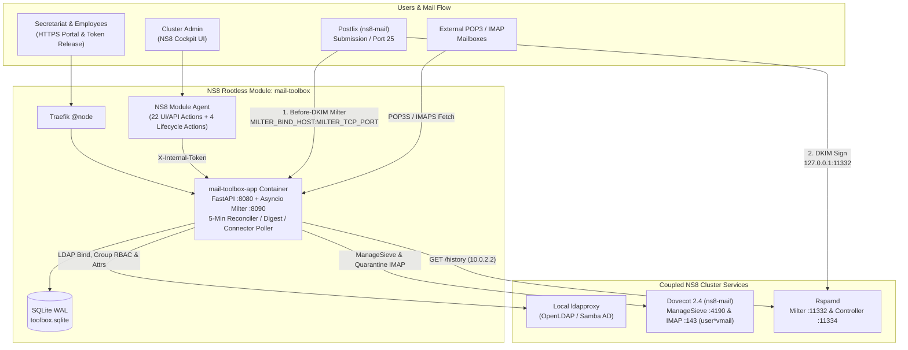

# NS8 Mail Toolbox (`ns8-mail-toolbox`)

**Enterprise Mail Operations Suite for NethServer 8 (`ns8-mail` + `ns8-sogo`)**  
*Delegated Sick-Leave & Forwarding Portal, Before-DKIM Company Signatures, Daily Spam Quarantine Digest with Self-Service Release, Rspamd Mail-Tracking Search, and External POP3/IMAP Connectors*

[](https://github.com/GeneraBlack/ns8-mailtoolbox/actions/workflows/test.yml)
[](https://github.com/GeneraBlack/ns8-mailtoolbox/actions/workflows/build-images.yml)
[](./LICENSE)

---

## Overview & Problem Solved

In small and medium-sized organizations running **NethServer 8 (`ns8-mail` + `ns8-sogo`)**, daily mail operations frequently hit administrative bottlenecks that previously required resetting employee passwords, granting full NS8 cluster-admin privileges, or deploying separate third-party gateways.

**`ns8-mail-toolbox`** solves five core mail operations challenges inside a single native, rootless NethServer 8 module:

1. **Delegated Sick-Leave / Out-of-Office & Deputy Forwarding (Without Password Resets):**
   - Provides a standalone HTTPS **Secretariat Web Portal** behind Traefik restricted via Active Directory / OpenLDAP group RBAC (e.g. `mail-office` or `hr-team`).
   - Office managers and HR staff can enable or schedule out-of-office auto-replies, configure deputy mail forwarding (`redirect :copy` or pure forwarding), and insert standardized company templates **without touching employee passwords** and **without needing NS8 Cockpit access**.
   - **Full Non-Destructive SOGo Coexistence (`sogo.sieve`):** Uses Dovecot 2.4 ManageSieve Master-User authentication (`<user>*vmail` over port `4190`). Personal `~/sieve/sogo.sieve` scripts are **never overwritten or deleted**: personal SOGo folder rules remain active via `include :personal "sogo";`, conflicting personal vacation replies are safely paused to prevent double auto-responses, a **5-minute reconciler** protects central rules from SOGo's nightly `00:00` `sogo-tool update-autoreply` cronjob, and previous user scripts are automatically restored on expiration or module uninstallation.

2. **Central Before-DKIM Company Signatures (Outlook, Thunderbird, Mobile, Apple Mail & SOGo):**
   - Pure-Python `asyncio` binary Postfix Milter listening on `${MILTER_BIND_HOST}:${MILTER_TCP_PORT}` (`127.0.0.1` on the same node or automatically bound to the node's internal NS8 **WireGuard VPN IP** in multi-node clusters).
   - **100% Valid DKIM & DMARC:** Postfix passes authenticated outbound mail (`{auth_authen}`) to `ns8-mail-toolbox` **before** Rspamd (`127.0.0.1:11332`), ensuring Rspamd computes DKIM signatures over the final signed MIME body. Unauthenticated inbound mail on port 25 is accepted untouched (`SMFIR_ACCEPT`).
   - **Dynamic AD/LDAP Placeholders & Smart Empty-Line Removal:** Supports `{{givenName}}`, `{{sn}}`, `{{displayName}}`, `{{mail}}`, `{{telephoneNumber}}`, `{{mobile}}`, `{{title}}`, `{{department}}`, `{{company}}`, conditional blocks (`{{#mobile}}...{{/mobile}}`), and automatic removal of entire HTML/plaintext lines when referenced AD fields are empty.
   - **Reply-Chain & Attachment Safety:** Rule precedence (`group` > `domain` > `default`), duplicate prevention (`append_once`, `first_only`, `always`), `below_reply` or `bottom` placement, and lossless handling of `multipart/mixed`, `multipart/alternative`, and `multipart/related` messages including PDF attachments and inline `cid:` images.

3. **Daily Spam Quarantine Digest & Scanner-Safe Self-Service Release:**
   - Inspects per-user `Junk` folders via Dovecot IMAP Master-User authentication and sends a clean daily digest email at the configured local time (e.g. `07:30 Europe/Berlin`) **only** to users who received new spam messages.
   - **Link-Scanner-Safe Two-Step Release:** `GET /api/quarantine/token/{token}` performs a non-consuming read-only preview so corporate email security scanners cannot accidentally trigger releases. Only an explicit user confirmation (`POST /api/quarantine/action`) moves the message from `Junk` to `INBOX` (triggering Dovecot `imapsieve` ham learning) and optionally adds the sender to the user's allowlist (`release_and_allow`).

4. **Fast Rspamd Mail-Tracking Search (With Persistent SQLite History):**
   - Polls Rspamd Controller `/history` (`127.0.0.1:11334` via rootless `slirp4netns` host loopback `10.0.2.2`) into a deduplicated local SQLite table (`mail_history_cache`), preserving searchable delivery logs (`delivered`, `spam`, `greylisted`, `rejected`, scores, symbols, Message-ID, client IP) well beyond Rspamd's in-memory ring buffer.
   - Can optionally be exposed in **read-only mode** inside the Secretariat Web Portal (`portal_tracking_enabled`) so reception staff can verify whether expected customer emails arrived without Cockpit admin privileges.

5. **External POP3/IMAP Mail Connectors with Automatic Admin Failure Alerts:**
   - Periodically fetches external mailboxes (`imaps`, `imap`, `pop3s`, `pop3`) with Fernet-encrypted credentials at rest (`APP_SECRET_KEY`), UID/UIDL deduplication (`leave_on_server` configurable), and local SMTP delivery.
   - Automatically sends a warning email (with 24-hour alert cooldown) to `admin_alert_email` and flags the Cockpit status dashboard whenever an external provider login fails (for example, after an external password change).

---

## Architecture & Update Safety



### Update Safety with `ns8-mail` and `ns8-sogo`
- **Zero Container Patching:** `ns8-mail-toolbox` runs in its own isolated rootless Podman user namespace and communicates exclusively via official NS8 authorizations (`traefik@node:routeadm`, `mail@any:mailadm`, `cluster:accountconsumer`), standard RFC protocols (ManageSieve, IMAP, SMTP, LDAP, HTTP, Milter), and NS8 persistent environment hooks (`POSTFIX_MILTERS`).
- **Cluster Event Listeners:** Automatically refreshes service endpoints and mailbox/alias caches whenever `ns8-mail` emits `mail-settings-changed` or the account provider emits `user-domain-changed`.

---

## Installation

### Method 1: Install via NS8 CLI (`add-module`)
Run on your NethServer 8 leader node (replace `1` with the target node ID, ideally the node hosting `ns8-mail`):

```bash
add-module ghcr.io/generablack/mail-toolbox:latest 1
```

### Method 2: Install via NS8 Software Center
Tagged releases publish an NS8 Software Center repository index (`repodata.json` + `metadata.json`):
1. In NS8 Cockpit, open **Settings -> Software repositories -> Add repository**.
2. Set **Name** to `Mail Toolbox` and **URL** to `https://generablack.github.io/ns8-mailtoolbox/`.
3. Open **Software Center**, locate **Mail Toolbox**, and install it onto the target node.

---

## Configuration Guide

### 1. Coupling `ns8-mail` & Secretariat Portal (`Settings`)
Open **Applications -> Mail Toolbox -> Settings** in NS8 Cockpit:
1. **Mail Server (`ns8-mail`):** Select your `ns8-mail` instance (co-located instances on the same node are highlighted as recommended).
2. **Secretariat Portal Hostname:** Enter a dedicated FQDN (e.g. `mailoffice.example.com`) and enable **Let's Encrypt** and **HTTP to HTTPS**.
3. **Authorized Secretariat Groups:** Select one or more AD/LDAP groups (e.g. `mail-office`) permitted to sign in to the Secretariat Web Portal.
4. **Optional Portal Mail Tracking:** Enable *Allow read-only mail tracking search in Secretariat Portal* (`portal_tracking_enabled`) if secretariat staff should be able to look up incoming/outgoing delivery statuses.

### 2. Activating & Resetting the Before-DKIM Signature Milter (`Signatures`)
Open **Applications -> Mail Toolbox -> Signatures** to create HTML/Plaintext signature rules, test live AD/LDAP rendering per user, and copy the exact pre-filled Postfix hook command for your `ns8-mail` instance:

```bash
# Activate Before-DKIM Signature Milter ahead of Rspamd (127.0.0.1:11332):
runagent -m mail1 python3 -c "import agent; agent.set_env('POSTFIX_MILTERS', 'inet:127.0.0.1:<MILTER_TCP_PORT>, inet:127.0.0.1:11332'); agent.dump_env()" && runagent -m mail1 systemctl --user reload postfix

# Rollback / Reset ns8-mail Postfix Milter to default (e.g. before uninstalling mail-toolbox):
runagent -m mail1 python3 -c "import agent; agent.unset_env('POSTFIX_MILTERS'); agent.dump_env()" && runagent -m mail1 systemctl --user reload postfix
```

> **Multi-Node Note:** When `mail-toolbox` and `ns8-mail` run on different cluster nodes, `mail-toolbox` automatically binds `MILTER_TCP_PORT` to the node's internal NS8 WireGuard VPN IP (`MILTER_BIND_HOST`) instead of `127.0.0.1` and populates that exact VPN IP in the Cockpit snippet.

### 3. Rspamd Mail-Tracking, Quarantine Digest & Connectors
- **Rspamd Controller Connection:** Enter the Rspamd Controller URL (`http://127.0.0.1:11334` when on the same node) and password in **Settings**, then click **Test Rspamd connection**.
- **Daily Quarantine Digest:** Enable the daily digest schedule (`HH:MM` and IANA timezone, e.g. `07:30` / `Europe/Berlin`) or trigger an immediate run from **Mail Tracking -> Quarantine**.
- **External POP3/IMAP Connectors:** Configure external accounts under **Connectors** (including quick presets for common providers, connection testing, manual sync, and `admin_alert_email` failure notifications).

---

## Backup, Restore, Migration & Clean Uninstall

- **Online Restic Backups:** `imageroot/bin/module-dump-state` runs `sqlite3.Connection.backup()` to create a consistent online snapshot (`data/toolbox-backup.sqlite`), and `imageroot/etc/state-include.conf` includes `state/environment`, `state/config/internal.token`, `state/config/toolbox_settings.json`, and `state/data/toolbox.sqlite`.
- **Restore & Cluster Move (`restore-module` / `clone-module`):** Re-binds `ldapproxy` and Traefik routes on the target node, recalculates `WEB_TCP_PORT`, `MILTER_TCP_PORT`, and `MILTER_BIND_HOST`, restores encrypted secrets, and triggers immediate ManageSieve reconciliation (`/api/internal/reconcile`).
- **Clean Uninstall (`destroy-module`):** Automatically calls `POST /api/internal/deactivate-all-vacations` before stopping `mail-toolbox.service` so all active `toolbox-vacation` Sieve scripts are removed and user `sogo` scripts are restored cleanly.

---

## Local Development & Testing

```bash
# 1. Build Secretariat Web Portal (Vue 3 + Vite)
npm --prefix app/frontend ci
npm --prefix app/frontend run build

# 2. Lint & Build NS8 Cockpit UI (Vue 2 + Carbon)
npm --prefix ui ci --legacy-peer-deps
npm --prefix ui run lint
npm --prefix ui run build

# 3. Run Backend, NS8 Static Rules, JSON Schema & Wire-Protocol E2E Test Suites
pip install -r app/backend/requirements.txt pytest httpx jsonschema pyyaml
pytest app/backend/tests tests -v

# 4. Build NS8 OCI Images (Linux with Podman + Buildah)
REPOBASE=ghcr.io/generablack IMAGETAG=latest bash build-images.sh
```

---

## License

Licensed under the **GNU General Public License v3.0 or later** (`GPL-3.0-or-later`). See [LICENSE](./LICENSE) for details.
