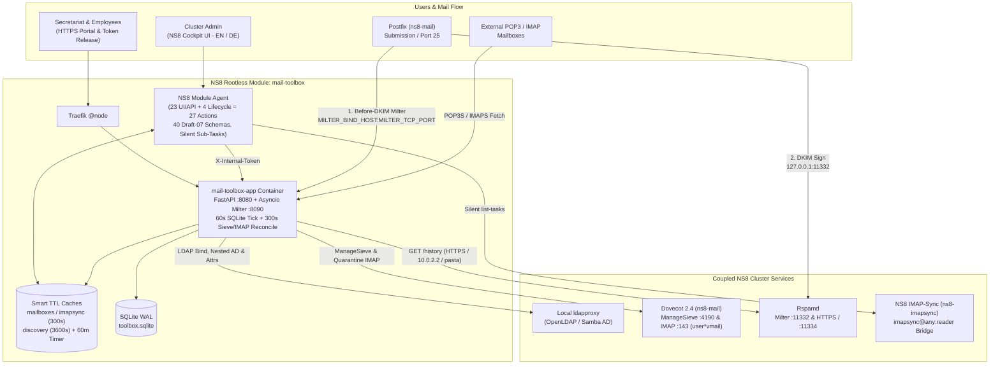

# NS8 Mail Toolbox (`ns8-mail-toolbox`)

**Enterprise Mail Operations Suite for NethServer 8 (`ns8-mail` + `ns8-sogo` + `ns8-imapsync`)**  
*Bilingual (`EN | DE`) Delegated Sick-Leave & Forwarding Portal, Before-DKIM Company Signatures, Daily Spam Quarantine Digest with Two-Step Self-Service Release, Rspamd Mail-Tracking Search, and External POP3/IMAP Connectors & NS8 IMAP-Sync Bridge*

[](https://github.com/BLS-ISP/ns8-mailtoolbox/actions/workflows/test.yml)
[](https://github.com/BLS-ISP/ns8-mailtoolbox/actions/workflows/build-images.yml)
[](https://github.com/BLS-ISP/ns8-mailtoolbox/releases/latest)
[](./LICENSE)

---

## Overview & Problem Solved

In small and medium-sized organizations running **NethServer 8 (`ns8-mail` + `ns8-sogo`)**, daily mail operations frequently hit administrative bottlenecks that previously required resetting employee passwords, granting full NS8 cluster-admin privileges, or deploying separate third-party gateways.

**`ns8-mail-toolbox`** solves five core mail operations challenges inside a single native, rootless NethServer 8 module — with full **English (`EN`, default) and German (`DE`)** user interfaces across both NS8 Cockpit and the standalone Secretariat Web Portal:

1. **Delegated Sick-Leave / Out-of-Office & Deputy Forwarding (Without Password Resets):**
   - Provides an optional standalone HTTPS **Secretariat Web Portal** behind Traefik restricted via Active Directory / OpenLDAP group RBAC (e.g. `mail-office` or `hr-team`), or operates in **Cockpit-only mode** when no public hostname is needed.
   - Office managers and HR staff can enable or schedule out-of-office auto-replies, configure deputy mail forwarding (`redirect :copy` or pure forwarding), and insert standardized company templates **without touching employee passwords** and **without needing NS8 Cockpit access**.
   - **Full Non-Destructive SOGo Coexistence (`sogo.sieve`):** Uses Dovecot 2.4 ManageSieve Master-User authentication (`<user>*vmail` over port `4190`). Personal `~/sieve/sogo.sieve` scripts are **never overwritten or deleted**: personal SOGo folder rules remain active via `include :personal "sogo";`, conflicting personal vacation replies are safely paused to prevent double auto-responses, a **5-minute ManageSieve reconciler** protects central rules from SOGo's nightly `00:00` `sogo-tool update-autoreply` cronjob, and previous user scripts are automatically restored on expiration or module uninstallation.

2. **Central Before-DKIM Company Signatures (Outlook, Thunderbird, Mobile, Apple Mail & SOGo):**
   - Pure-Python `asyncio` binary Postfix Milter listening on `${MILTER_BIND_HOST}:${MILTER_TCP_PORT}` (`127.0.0.1` on the same node or automatically bound to the node's internal NS8 **WireGuard VPN IP** in multi-node clusters).
   - **100% Valid DKIM & DMARC:** Postfix passes authenticated outbound mail (`{auth_authen}`) to `ns8-mail-toolbox` **before** Rspamd (`127.0.0.1:11332`), ensuring Rspamd computes DKIM signatures over the final signed MIME body. Unauthenticated inbound mail on port 25 is accepted untouched (`SMFIR_ACCEPT`).
   - **Dynamic AD/LDAP Placeholders & Smart Empty-Line Removal:** Supports `{{givenName}}`, `{{sn}}`, `{{displayName}}`, `{{mail}}`, `{{telephoneNumber}}`, `{{mobile}}`, `{{title}}`, `{{department}}`, `{{company}}`, conditional blocks (`{{#mobile}}...{{/mobile}}`), and automatic removal of entire HTML/plaintext lines when referenced AD fields are empty.
   - **Reply-Chain & Attachment Safety:** Rule precedence (`group` > `domain` > `default`), duplicate prevention (`append_once`, `first_only`, `always`), `below_reply` or `bottom` placement, and lossless handling of `multipart/mixed`, `multipart/alternative`, and `multipart/related` messages including PDF attachments and inline `cid:` images.

3. **Daily Spam Quarantine Digest & Scanner-Safe Self-Service Release:**
   - Inspects per-user `Junk` folders via Dovecot IMAP Master-User authentication and sends a clean localized (`EN` or `DE`) daily digest email at the configured local time (e.g. `07:30 Europe/Berlin`) **only** to users who received new spam messages.
   - **Link-Scanner-Safe Two-Step Release:** `GET /api/quarantine/token/{token}` performs a non-consuming read-only preview so corporate email security scanners cannot accidentally trigger releases. Only an explicit user confirmation (`POST /api/quarantine/action`) moves the message from `Junk` to `INBOX` (triggering Dovecot `imapsieve` ham learning) and optionally adds the sender to the user's allowlist (`release_and_allow`).

4. **Fast Rspamd Mail-Tracking Search (With Persistent SQLite History):**
   - Auto-discovers `https://<mail-hostname>/rspamd` (supporting Traefik `forward_auth` HTTP Basic Auth, `rspamd_tls_verify=false` self-signed TLS certificates, and split-DNS/hairpin-NAT fallback) as well as local `http://127.0.0.1:11334` (automatically mapped across Podman 4 `slirp4netns` `10.0.2.2` and Podman 5 `pasta:--map-gw` `host.containers.internal`), persisting deduplicated `/history` records in SQLite (`mail_history_cache`) well beyond Rspamd's in-memory ring buffer.
   - Can optionally be exposed in **read-only mode** inside the Secretariat Web Portal (`portal_tracking_enabled`) so reception staff can verify whether expected customer emails arrived without Cockpit admin privileges.

5. **External POP3/IMAP Mail Connectors, NS8 IMAP-Sync (`ns8-imapsync`) Bridge & Admin Alerts:**
   - Periodically fetches external mailboxes (`imaps`, `imap`, `pop3s`, `pop3`) with Fernet-encrypted credentials at rest (`APP_SECRET_KEY`), UID/UIDL deduplication (`leave_on_server` configurable), and local SMTP delivery.
   - **Automatic `ns8-imapsync` Sync Bridge:** Whenever one or more official **NS8 IMAP-Sync (`ns8-imapsync`)** instances (`imapsync1`, etc.) are installed on the cluster, their sync tasks are automatically discovered and displayed alongside native Mail Toolbox connectors in Cockpit (`Connectors` & `Status`) with direct Start, Stop, Live Log Viewer, and deep-link controls.
   - Automatically sends a localized warning email (with a 24-hour alert cooldown) to `admin_alert_email` and flags the Cockpit status dashboard whenever a native POP3/IMAP connector or coupled `ns8-imapsync` task fails.

---

## Architecture & Update Safety



### Update Safety with `ns8-mail`, `ns8-sogo`, and `ns8-imapsync`
- **Zero Container Patching:** `ns8-mail-toolbox` runs in its own isolated rootless Podman user namespace and communicates exclusively via official NS8 authorizations (`traefik@node:routeadm`, `mail@any:mailadm`, `cluster:accountconsumer`, `imapsync@any:reader`), standard RFC protocols (ManageSieve, IMAP, SMTP, LDAP, HTTP/HTTPS, Milter), and NS8 persistent environment hooks (`POSTFIX_MILTERS`).
- **Rootless Podman 4 & Podman 5 Compatibility:** `imageroot/bin/discover-services` automatically detects Podman 4 `slirp4netns:allow_host_loopback=true` (`10.0.2.2`) vs Podman 5 `pasta:--map-gw` (`host.containers.internal`), ensuring local host gateway connections work reliably across Rocky Linux 9, Debian 12, and upgraded container runtimes.
- **Cluster Event Listeners:** Automatically refreshes service endpoints, mailbox/alias caches, and `ns8-imapsync` bridge state whenever `ns8-mail` emits `mail-settings-changed`, the account provider emits `user-domain-changed`, or the 60-minute background cache sync timer fires.

---

## Internationalization & Multi-Language Support (`EN` & `DE`)

- **English (`en`) Default Out of the Box:** All interfaces, seeded templates (`default_en` and `default_de`), daily quarantine digest emails, and administrator failure alert emails default to **English (`en`)**, with complete **100% key-parity German (`de`)** translations included.
- **NS8 Cockpit UI (`ui/`):** Automatically follows the active NS8 Cockpit shell language (`en` or `de`, falling back cleanly to `en` for other locales) and provides an instant **`EN | DE`** language toggle in the application side menu (`ns8_mail_toolbox_cockpit_lang`).
- **Secretariat Portal & Quarantine Release SPA (`app/frontend/`):** Provides a persistent **`EN | DE`** switcher in the top navigation bar (`ns8_mail_toolbox_lang` in `localStorage`) for both authenticated secretariat staff and unauthenticated employees releasing quarantined emails.

---

## Silent Background Tasks & Cache-First Performance (`v1.0.5`)

- **Zero Cluster-Admin Toast Flood:** 100% of internal `agent.tasks.run(...)` calls across `imageroot/` (`11/11`) and all background/read/quick-action UI tasks across `ui/src/` (`40/41`, leaving only `configure-module` in `Settings` visible in the NS8 task drawer) pass `isNotificationHidden: true`, completely eliminating untitled completion notifications in NS8 Cockpit and Software Center.
- **Smart TTL Sub-Task Caching (>90% Fewer NS8 Tasks):**
  - `list-mailboxes` and `list-connectors` serve local `./config/mailboxes_cache.json` and `./config/imapsync_cache.json` with **zero child NS8 tasks** whenever the cache is `< 300` seconds (5 minutes) old; clicking the manual **Refresh** button in Cockpit passes `{"force_refresh": true}` for an immediate live refresh.
  - `get-configuration` reuses `./config/discovery_cache.json` (`3600`s TTL) and saved `RSPAMD_URL`, performing **zero** `get-filter-configuration` sub-tasks once configured.
  - `mail-toolbox-sync.timer` runs quietly every **60 minutes**, while inside `mail-toolbox-app` lightweight local SQLite checks (scheduled digest, due POP3/IMAP connectors, `ns8-imapsync` alert checks) run on a `60`s tick and network ManageSieve/IMAP reconciliation runs every `300`s (5 minutes).

---

## Installation

### Method 1: Install via NS8 CLI (`add-module`)
Run on your NethServer 8 leader node (replace `1` with the target node ID, ideally the node hosting `ns8-mail`):

```bash
add-module ghcr.io/bls-isp/mail-toolbox:latest 1
```

### Method 2: Install via NS8 Software Center (`BLS-ISP/ns8-nethforge`)
`Mail Toolbox` is published in the BLS-ISP NethServer 8 Software Center repository (`https://github.com/BLS-ISP/ns8-nethforge`):
1. In NS8 Cockpit, open **Settings -> Software repositories -> Add repository**.
2. Set **Name** to `bls-isp` and **URL** to `https://raw.githubusercontent.com/BLS-ISP/ns8-nethforge/repomd/ns8/updates/`.
3. Open **Software Center**, locate **Mail Toolbox**, and install it onto the target node.

---

## Configuration Guide

### 1. Coupling `ns8-mail`, AD/LDAP Groups & Optional Secretariat Portal (`Settings`)
Open **Applications -> Mail Toolbox -> Settings** in NS8 Cockpit:
1. **Mail Server (`ns8-mail`) & Live Discovery:** Select your `ns8-mail` instance (co-located instances on the same node are highlighted as recommended). Switching mail instances invokes `discover-mail-instance` to live-discover the coupled user domain, real Active Directory / OpenLDAP groups (with resolved member counts and a filter hiding built-in Windows AD system groups by default), and the Rspamd endpoint URL even before saving for the first time.
2. **Optional Secretariat Web Portal:** Keep the Traefik portal enabled and enter a dedicated FQDN (e.g. `mailoffice.example.com`) with **Let's Encrypt** and **HTTP to HTTPS**, or toggle `portal_enabled` off to operate in Cockpit-only mode without allocating a public virtual host.
3. **Authorized Secretariat Groups & Nested AD Support:** Select zero or more AD/LDAP groups (leaving `allowed_groups` empty keeps Secretariat login disabled while preserving Cockpit management and public quarantine release links). Full Active Directory group semantics are supported out of the box: multi-level nested groups (`1.2.840.113556.1.4.1941` + iterative BFS graph traversal), AD Primary Groups (`primaryGroupID` / `objectSid` RIDs such as `Domain Users`), custom `userPrincipalName` (`user@upn.domain`), `DOMAIN\user`, and OpenLDAP `rfc2307` / `groupOfNames`.
4. **Optional Portal Mail Tracking:** Enable *Allow read-only mail tracking search in Secretariat Portal* (`portal_tracking_enabled`) if secretariat staff should be able to look up incoming/outgoing delivery statuses.

### 2. Activating & Resetting the Before-DKIM Signature Milter (`Signatures`)
Open **Applications -> Mail Toolbox -> Signatures** to create HTML/Plaintext signature rules, test live AD/LDAP rendering per user, and copy the exact pre-filled Postfix hook command for your `ns8-mail` instance:

```bash
# Activate Before-DKIM Signature Milter ahead of Rspamd (127.0.0.1:11332):
runagent -m mail1 python3 -c "import agent; agent.set_env('POSTFIX_MILTERS', 'inet:127.0.0.1:<MILTER_TCP_PORT>, inet:127.0.0.1:11332')" && runagent -m mail1 systemctl --user reload postfix

# Rollback / Reset ns8-mail Postfix Milter to default (e.g. before uninstalling mail-toolbox):
runagent -m mail1 python3 -c "import agent; agent.unset_env('POSTFIX_MILTERS')" && runagent -m mail1 systemctl --user reload postfix
```

> **Multi-Node Note:** When `mail-toolbox` and `ns8-mail` run on different cluster nodes, `mail-toolbox` automatically binds `MILTER_TCP_PORT` to the node's internal NS8 WireGuard VPN IP (`MILTER_BIND_HOST`) instead of `127.0.0.1` and populates that exact VPN IP in the Cockpit snippet.

### 3. Rspamd Mail-Tracking, Quarantine Digest & Connectors
- **Rspamd Controller Auto-Discovery, Basic Auth & Self-Signed TLS:** `Mail Toolbox` automatically discovers the Rspamd URL from `ns8-mail` (such as `https://mail.example.com/rspamd` via Traefik `forward_auth` or `http://127.0.0.1:11334` locally), normalizes `/history` suffixes, accepts self-signed NS8 TLS certificates by default (`rspamd_tls_verify=false`), supports both Traefik HTTP Basic Auth (`rspamd_user` + `rspamd_password`) and direct `Password` headers, and includes split-DNS / hairpin-NAT fallback plus one-click connection testing.
- **Daily Quarantine Digest:** Enable the daily digest schedule (`HH:MM` and IANA timezone, e.g. `07:30` / `Europe/Berlin`) or trigger an immediate run from **Mail Tracking -> Quarantine**.
- **External POP3/IMAP Connectors & NS8 IMAP-Sync Bridge:** Configure native POP3/IMAP accounts under **Connectors** (including quick presets for common providers, connection testing, manual sync, and `admin_alert_email` failure notifications). Any installed `ns8-imapsync` instances coupled to the mail server appear automatically in the same unified table with Start/Stop/Log actions and shared `admin_alert_email` monitoring.

---

## Backup, Restore, Migration & Clean Uninstall

- **Online Restic Backups:** `imageroot/bin/module-dump-state` runs `sqlite3.Connection.backup()` to create a consistent online snapshot (`data/toolbox-backup.sqlite`), and `imageroot/etc/state-include.conf` includes `state/environment`, `state/config/internal.token`, `state/config/toolbox_settings.json`, `state/data/toolbox.sqlite`, and `state/data/toolbox-backup.sqlite`.
- **Restore & Cluster Move (`restore-module` / `clone-module`):** Re-binds `ldapproxy` and Traefik routes on the target node, recalculates `WEB_TCP_PORT`, `MILTER_TCP_PORT`, and `MILTER_BIND_HOST`, restores encrypted secrets, and triggers immediate ManageSieve reconciliation (`/api/internal/reconcile`).
- **Clean Uninstall (`destroy-module`):** Automatically calls `POST /api/internal/deactivate-all-vacations` before stopping `mail-toolbox.service` so all active `toolbox-vacation` Sieve scripts are removed and user `sogo` scripts are restored cleanly.

---

## Repository Structure & Component Docs

| Path | Description |
| :--- | :--- |
| [`./CHANGELOG.md`](./CHANGELOG.md) | Release history (`v1.0.0` through `v1.0.5`) in Keep a Changelog format |
| [`./imageroot/README.md`](./imageroot/README.md) | NS8 rootless module agent, systemd user units, discovery/cache helpers, events, and all 27 NS8 actions |
| [`./ui/README.md`](./ui/README.md) | NS8 Cockpit Admin UI (`Vue 2.7` + `@nethserver/ns8-ui-lib` + Carbon Design System, `EN \| DE`) |
| [`./app/README.md`](./app/README.md) | Runtime `mail-toolbox-app` container (`FastAPI` `:8080`, `asyncio` Postfix Milter `:8090`, SQLite WAL) |
| [`./app/frontend/README.md`](./app/frontend/README.md) | Standalone `Vue 3 + Vite` Secretariat Web Portal & Two-Step Spam Quarantine Release SPA (`EN \| DE`) |
| [`./tests/README.md`](./tests/README.md) | Static NS8 architecture/schema/i18n guards and live wire-protocol E2E test suites |

---

## Troubleshooting & FAQ

### 1. Rspamd Connection Fails with HTTP 401/403 or Self-Signed TLS Errors
- When Rspamd is exposed via `https://<mail-hostname>/rspamd`, NS8's Traefik `forward_auth` middleware requires valid Cluster-Admin credentials (`rspamd_user` + `rspamd_password` in **Settings -> Mail Tracking & Quarantine**).
- Self-signed or internal CA certificates are accepted by default (`rspamd_tls_verify=false`). Enable *Verify TLS certificate* only when your mail hostname uses a publicly trusted certificate (e.g. Let's Encrypt).
- If the node cannot resolve its own public FQDN due to split-DNS or hairpin-NAT restrictions, `mail-toolbox` automatically retries against the local host gateway (`http://10.0.2.2:11334` / `http://host.containers.internal:11334`) when co-located on the same node. Use **Test Rspamd connection** in **Settings** to verify live reachability.

### 2. Expected Active Directory Groups or Nested Group Members Do Not Appear
- Built-in Windows AD system groups (`Domain Computers`, `Cert Publishers`, `DnsAdmins`, etc.) are hidden by default in **Settings** to keep the group selector clean. Enable **Show built-in AD system groups** to select groups such as `Domain Users` or `Domain Admins`.
- Multi-level nested AD groups (`LDAP_MATCHING_RULE_IN_CHAIN` `1.2.840.113556.1.4.1941` plus iterative BFS fallback), AD primary groups (`primaryGroupID` / `objectSid` RIDs), `user@upn.domain` custom UPN suffixes, and `DOMAIN\user` logins are resolved automatically for both Secretariat Portal RBAC and group-scoped signature rules.

### 3. Running `mail-toolbox` and `ns8-mail` on Different Cluster Nodes
- Co-locating `mail-toolbox` on the same node as `ns8-mail` is recommended for lowest latency, but multi-node deployments are fully supported.
- When coupled to a remote `ns8-mail` node, `configure-module`, `restore-module`, and `clone-module` automatically bind `MILTER_BIND_HOST` to the local node's internal NS8 **WireGuard VPN IP** (`node/<id>/vpn`) instead of `127.0.0.1` and generate the exact cross-node `POSTFIX_MILTERS` command snippet under **Signatures**.

### 4. NS8 IMAP-Sync (`ns8-imapsync`) Tasks After In-Place Module Upgrades
- Fresh installations (`>= v1.0.4`) receive the `imapsync@any:reader` NS8 RBAC authorization automatically, enabling both background failure-alert polling and server-side cache population.
- On instances upgraded in-place from `v1.0.0`–`v1.0.3` (where NS8 preserves original create-time Redis ACLs), Cockpit's `Connectors` and `Status` views seamlessly fall back to Cluster-Admin UI task queries (`tasks_loaded: false` -> UI `list-tasks`) without errors. Only `ns8-imapsync` instances coupled to the same `ns8-mail` server are shown by default; toggle **Show uncoupled instances** in **Connectors** to inspect other `imapsync` modules in the cluster.

---

## Local Development & Testing

```bash
# 1. Build Secretariat Web Portal (Vue 3 + Vite)
npm --prefix app/frontend ci
npm --prefix app/frontend run build

# 2. Lint & Build NS8 Cockpit UI (Vue 2 + Carbon)
npm --prefix ui ci --legacy-peer-deps
npm --prefix ui run lint
npm --prefix ui run build

# 3. Run Backend, NS8 Static Rules, JSON Schema & Wire-Protocol E2E Test Suites
pip install -r app/backend/requirements.txt pytest pytest-asyncio httpx jsonschema pyyaml
pytest app/backend/tests tests -v

# 4. Build NS8 OCI Images (Linux with Podman + Buildah)
REPOBASE=ghcr.io/bls-isp IMAGETAG=latest bash build-images.sh
```

---

## License

Licensed under the **GNU General Public License v3.0 or later** (`GPL-3.0-or-later`). See [LICENSE](./LICENSE) for details.
